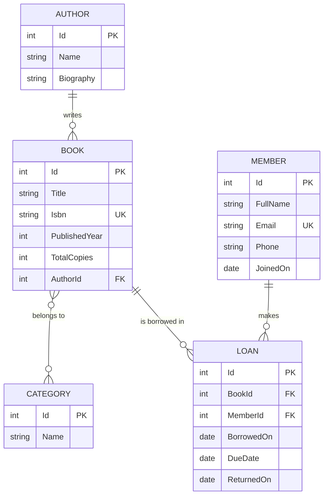

# 📚 Library Management System


A library management web app built with **ASP.NET Core Razor Pages**, **Entity Framework Core (Code First)** and **SQL Server**.

It manages authors, books, categories, members and loans, and enforces real borrowing rules such as loan limits, copy availability and due dates. I built it step by step as a practice project to apply what I learned in my C# and .NET course: OOP, LINQ, EF Core, Razor Pages, validation and dependency injection.

> Part of my learning journey: see my [C# and .NET Learning Repository](https://github.com/Ahmed-Sameh237/csharp-and-dotnet).

---

## ✨ Features

- **Authors**: create, edit, view and delete. An author who still has books can't be deleted.
- **Books**: full CRUD with an author dropdown and category checkboxes (many-to-many). ISBNs are unique.
- **Search, filter and paging** on the books list: by title, author or ISBN, by category, and "available only". Filters live in the URL, so results are bookmarkable.
- **Members**: full CRUD with email validation, unique emails and a loan history on each member's page.
- **Borrow and return**: a `LoanService` enforces the library rules in one place.
- **Loans list**: filter by active, overdue or all loans, with a Return button on each active loan.
- **Reports**: summary cards, most borrowed books, loans per member, loans by category and an overdue list.

## 📏 Business Rules

| Rule | Where it's enforced |
|---|---|
| A member can have at most **3 active loans** | `LoanService.BorrowAsync` |
| A member can't borrow **the same book twice** at once | `LoanService.BorrowAsync` |
| A book can only be borrowed if a **copy is available** | `LoanService.BorrowAsync` |
| A loan is due **14 days** after borrowing | `LoanService.BorrowAsync` |
| A loan is **overdue** when it is past its due date and not returned | `Loan.IsOverdue` |
| Total copies can't drop below the number currently borrowed | Book Edit page |
| Books and members with loan history can't be deleted | Delete pages + `DeleteBehavior.Restrict` |
| ISBNs and member emails are unique | Page validation + unique indexes |

The UI shows friendly messages for these rules, and the database constraints stay in place as a safety net.

## 🗺️ Data Model



Availability is **computed** (`TotalCopies` minus active loans) instead of stored, so it can never drift out of sync with the loans table.

## 🧰 Tech Stack

- **C#** and **.NET 10**
- **ASP.NET Core Razor Pages**
- **Entity Framework Core** (Code First, Fluent API, migrations)
- **SQL Server**
- **Bootstrap 5** (included in the Razor Pages template)

## 🎓 Concepts Practiced

| Area | What this project uses |
|---|---|
| OOP and C# | Entities, navigation properties, computed properties, records, abstract base page model |
| EF Core | `DbContext`, one-to-many and many-to-many relationships, delete behaviors, unique indexes, seed data with `HasData`, migrations |
| LINQ | `Where`, `Select`, `OrderBy`, `Any`, `Count`, `Sum`, `GroupBy`, `Join`, `SelectMany`, projections, deferred execution |
| Razor Pages | Page models, GET and POST handlers, named handlers, route constraints, Tag Helpers, partial views |
| Validation | Data annotations, `ModelState`, custom rules, `TryUpdateModelAsync` to prevent overposting |
| Patterns | PRG (Post/Redirect/Get), `TempData` messages, service layer, result objects |
| Dependency Injection | `DbContext` and `ILoanService` injected into page models |

## 📁 Project Structure

```text
LibraryManagement/
├── LibraryManagement.Web/
│   ├── Data/            # LibraryContext, relationships, seed data
│   ├── Migrations/      # EF Core migrations
│   ├── Models/          # Author, Book, Category, Member, Loan
│   ├── Services/        # ILoanService, LoanService (business rules)
│   ├── Helpers/         # PaginatedList<T>
│   ├── ViewModels/      # Lightweight models for list pages
│   ├── Pages/
│   │   ├── Authors/     # Index, Details, Create, Edit, Delete
│   │   ├── Books/       # CRUD, shared form base model and partial
│   │   ├── Members/     # CRUD with loan history
│   │   ├── Loans/       # Index (list and return), Borrow
│   │   ├── Reports/     # Statistics and overdue list
│   │   └── Shared/      # Layout
│   ├── Program.cs
│   └── appsettings.json
├── .gitignore
└── README.md
```

## 🚀 Getting Started

### Prerequisites

- [.NET SDK](https://dotnet.microsoft.com/download) (the project targets `net10.0`)
- SQL Server (local install, LocalDB or Docker)
- The EF Core CLI tool:

  ```bash
  dotnet tool install --global dotnet-ef
  ```

### Setup

1. **Clone the repository**

   ```bash
   git clone https://github.com/Ahmed-Sameh237/library-management.git
   cd library-management/LibraryManagement.Web
   ```

2. **Set your connection string** in `appsettings.json`:

   ```json
   "ConnectionStrings": {
     "DefaultConnection": "Server=localhost;Database=LibraryDb;Trusted_Connection=True;TrustServerCertificate=True;"
   }
   ```

   Adjust it for your setup:
   - LocalDB: `Server=(localdb)\\MSSQLLocalDB;...`
   - SQL Server in Docker: `Server=localhost,1433;User Id=sa;Password=<your password>;TrustServerCertificate=True;`. For password-based connections, use [user secrets](https://learn.microsoft.com/aspnet/core/security/app-secrets) instead of committing credentials.

3. **Create the database** (applies all migrations and seed data):

   ```bash
   dotnet ef database update
   ```

4. **Run the app**

   ```bash
   dotnet run
   ```

   Open the URL printed in the terminal (for example `http://localhost:5024`).

### Seed Data

The first migrations insert sample data so the app is useful immediately:

- 4 authors, 5 categories and 6 books
- 2 members

## 🧪 Try It Out

1. Open **Books** and search for `orwell`.
2. Go to **Loans → Borrow a book** and borrow "1984" as a member.
3. Borrow it again as the same member and see the rule error.
4. Borrow three different books as one member and watch the dropdown disable them.
5. Return a loan, then open **Reports**.
6. To see an overdue loan, run this in SQL Server and open the Overdue tab:

   ```sql
   UPDATE Loans SET DueDate = DATEADD(day, -5, GETDATE()) WHERE Id = 1;
   ```

## 🛣️ Roadmap

- [x] Project setup, models and `DbContext`
- [x] Seed data and migrations
- [x] Authors, Books and Members CRUD
- [x] Borrow and return with business rules
- [x] Search, filtering, paging and reports
- [ ] Block borrowing for members with overdue loans
- [ ] Handle concurrent borrowing of the last copy (transaction or row version)
- [ ] Sortable columns and search on Authors and Members
- [ ] Authentication and roles (librarian vs member)
- [ ] AI feature: book recommendations or natural-language catalog search (RAG)
- [ ] Unit tests for `LoanService`

## 📝 Notes

- The app has **no authentication yet**. It's intended for learning and local use.
- Dates use `DateTime.Today`, so due dates are based on the server's local date.

## 👨‍💻 Author

**Ahmed Sameh**

- GitHub: [@Ahmed-Sameh237](https://github.com/Ahmed-Sameh237)

> **Learn → Build → Debug → Improve → Repeat**
